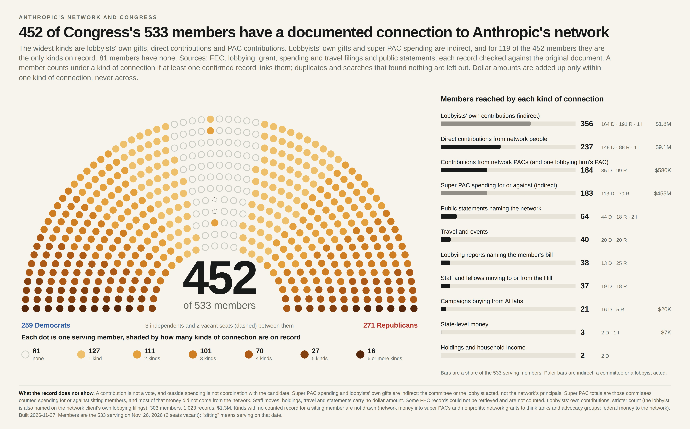

# Anthropic's network and Congress: the record, 29 figures, and the code that draws them

This repository holds a record of documented connections between Anthropic's network (Anthropic, its funders and the funders of the AI-safety field, the organisations they fund that work with Congress, and their officers, PACs and lobbyists) and the members of the 119th Congress: 135,719 rows in 15 tables (14 source tables, each row with its source, and a member table built from them). Members are counted as the 533 serving on November 26, 2026; two seats were vacant (`research/roster_serving.csv`). It also holds the 29 figures drawn from that record and the scripts that draw them, so anyone can rebuild every figure from the tables here.

**A connection is a documented record, not an allegation of influence.** A contribution is not a vote, and an independent expenditure is not coordination. No motive is asserted anywhere.

**Read it as a story:** [454 of 533](https://kevinnbass.github.io/anthropic-network-money-congress/), the record told in 5 slides, with four chapters that go deeper (6 more slides) and four other ways to read it (seven questions answered from the record; look up your member; the decade, year by year; a thread of cards for X), laid out for a desk and for a phone. On every page, the marks that stand for records (a seat, a bar, an amount) open those records in a side panel: date, who, to whom, amount, for or against, the source's own words and a link to the source, and a link that reopens the page with that panel open. It is a draft. Audit X92 checked the main story and chapters against an expanded list that includes every drawing. Audit X94 checked the other pages and left names inside quoted filings without an individual public-role check. The cover, the slide on the bigger money and five of the six chapter slides were then revised on what two readers said (round 17, November 28), and the questions page's first slide, which reuses the cover's drawing, changed with it; its audit (X95) found eight things that are not yet corrected: see the open list below. Every number on it is computed from the tables here, and each slide lists the rows behind it ([`docs/rows.json`](docs/rows.json)). [See the release history](HISTORY.md).



## Status: updated November 28, 2026; the final check's corrections applied, with the limits it stated

For serving members, against the version published here before:

| Kind of connection | Before (535 first seated) | Now (533 serving; Nov. 28) |
|---|---|---|
| Individuals' contributions | 202 members, $5.2M | 240 members, $9.2M |
| PAC contributions | 118 members, $328K | 190 members, $640K |
| Outside spending by committees with a network receipt (from their first network receipt) | 201 members, $525M | 184 members, $490M |
| Lobbyists' own contributions | 293 members, $1.2M | 356 members, $1.8M |
| Lobbying reports naming a bill the member sponsored | 8 members | 38 members |
| Any counted connection | 435 of 535 | 454 of 533 |

- **Repeated filings.** Some transactions appeared in both a notice and a regular report, in a filing and its amendment, or in both the giver's and recipient's reports. Each is counted once now.
- **Records that were not statements.** The statements table included witness and signatory lists, citations, reprints and duplicate entries. They are no longer counted. The audit also corrected the speaker, date, venue or excerpt where the document disagreed with the table.
- **Wrong speaker.** The audit found a Congressional Record quotation attributed to the wrong member. The statement counts only under the member who spoke it.
- **Missing member.** Some counted PAC gifts lacked the member's name. The receiving committees' registrations supplied the links.
- **Not a move.** Two commissioners were counted as moving from the network into a congressional body; Anthropic's own announcement shows both already served when it named them to an advisory council. Figure 05 counts 26 people in that direction, all fellows.
- **Restated lines.** Conduit or memo copies of counted gifts, refunds, repeated outside-spending lines and timeline method notes are held for reference.
- **Gifts restored to the count.** The same rule was tested on memo and conduit entries held for reference. Gifts passed through ActBlue were restored where the record held no receipt on the candidates' own reports. Neither candidate serves in Congress.
- **Lobbyists' gifts held out of the count.** The audit read the filed returns for held gifts that named a serving member and a person as the giver and fell in the counting window. Duplicate records and entries replaced or withdrawn by amendments stayed held for reference. The count uses the current return and names the member when the filing supplies the link. Each gift is still counted once.
- **One rule for committee receipts.** The figures on committee receipts and on where outside money went now both include qualifying receipts from the contributions table.
- **Captions and lists.** Captions that left out a condition the code applies were completed, and so were lists of cited rows that left out rows a figure counts.
- Outside spending now counts only from the day a committee received its first network gift on record. The figure table in `FIGURES.md` gives the current numbers.

**Not finished. Until these are done this update is not called verified:**

- Audit X86 closed with filing, identity, affiliation or date evidence still needed. The three evidence rows still listed without a completed check are the Center for AI Policy entry, an adviser's entry and a former official's note, described below.
- Five pairs of counted rows share a member, a date and a whole-dollar amount. Their filings still leave open whether each pair is one transaction or two ($27,399 of outside spending, $5,400 of contributions, $3,500 of lobbyists' gifts). Both rows of each pair are counted.
- The final check (X68) left seven verdict rows and a companion-study calculation unrecomputed. It could read only part of the sample for a counting rule, and some dated cells needed unavailable images.
- Audit X94 left names inside quoted filings without an individual public-role check.
- The eight things the audit of the story's November 28 revision (X95) found are corrected, and each has a written ruling. The corrected slides have not been audited again. Two readers of that revision asked for changes to the lobbying slide and others; those are the next round, which will be audited in full.
- Audit X93's remaining work covers numbers in the verdict table that lack a sentence-level source and older claims for which it could not recover the dated record. Those claims are in the [release history](HISTORY.md), each marked where it was not re-derived.
- The search for gaps continues. The remaining conduit gifts are being checked against the recipients' filings.
- Two cells on the three rows described below have corrected forms that a second review confirmed (4 of 4 lines); they are not yet applied, and the three rows have no audit as they will then stand.
- A sweep read all 135,731 quotation cells and found 1,802 counted rows whose quotation holds a saved page's markup, its header or a cut-off tag instead of the page's words; 1,462 of them are grant rows. A review confirmed the first 400 corrected quotations (400 of 400); 1,073 more are with reviewers and the rest are being written. None is applied yet. The same review read 60 counted rows the sweep had not flagged: 12 hold a quotation rebuilt from a filing's data fields, with field names changed or added, instead of the filing's own text, and one ends in a cut-off address. How many rows that is across the record has not been measured.
- The author has yet to decide how to count conduit receipts and whether a documented advisory council appointment qualifies when payment is undisclosed.

Corrections that come out of those checks are pushed here as they are applied. [`FIGURES.md`](FIGURES.md) gives each figure's reading and limits. A script checks the numbers in the verdict table from which these readings are exported. The audits read the wording.

## What is here

| Path | What it is |
|---|---|
| [`figures/`](figures) | The 29 figures, each as `.html` (the page itself), `.png` and `.jpg`. |
| [`FIGURES.md`](FIGURES.md) | For each figure: what it shows, and what cuts against that reading. |
| [`research/`](research) | The record: 15 tables and the helper tables the figures read. [`research/README.md`](research/README.md) explains the files, the columns and what was changed for this public copy. |
| [`case.json`](case.json) | Which rows count: each row's role (evidence, context or negative). The same roles are in `research/row_roles.csv`. |
| [`scripts/`](scripts), [`lib/`](lib) | The scripts that build the member table and draw the figures, and the small drawing library they use. |
| [`docs/`](docs) | The story series: one page of 5 slides (`index.html`, with its fonts) and four chapter pages (`deep1/` to `deep4/`, 6 slides), each with the words of each slide (`slides.json`), the rows behind each slide (`rows.json`), the rows behind each mark (`marks.json`) and the records the side panel shows (`records/`); and the four other ways to read it (`questions/`, `member/`, `decade/`, `thread/`, the last with its cards for X). GitHub Pages serves it at the address above. A draft. |
| [`figures-alt/`](figures-alt) | Three alternate views, drawn by the same code from the same rows. See "Alternate views" below for their status. |
| [`SCRUB-LOG.csv`](SCRUB-LOG.csv) | A count of the cells changed for this public copy: API keys and local file paths, nothing else. |
| `network-money-per-member.*`, [`data/`](data) | The chart of direct money per member and the rows it draws. See "Direct money per member" below. |

## The figures

Titles are as printed on each figure. [`FIGURES.md`](FIGURES.md) gives the full reading of each one and its limits.

| # | Title | Files |
|---|---|---|
| 01 | 454 of Congress's 533 members have a documented connection to Anthropic's network | [jpg](figures/congress-01-connection-grid.jpg) · [png](figures/congress-01-connection-grid.png) · [html](figures/congress-01-connection-grid.html) |
| 02 | Public First family money in and out, by race | [jpg](figures/congress-02-public-first-family-by-race.jpg) · [png](figures/congress-02-public-first-family-by-race.png) · [html](figures/congress-02-public-first-family-by-race.html) |
| 03 | Principals' hard money to sitting members | [jpg](figures/congress-03-principals-hard-money-by-party-and-cycle.jpg) · [png](figures/congress-03-principals-hard-money-by-party-and-cycle.png) · [html](figures/congress-03-principals-hard-money-by-party-and-cycle.html) |
| 04 | Lobbying spend and the lobbyists' Hill origins | [jpg](figures/congress-04-lobbying-spend-and-hill-origins.jpg) · [png](figures/congress-04-lobbying-spend-and-hill-origins.png) · [html](figures/congress-04-lobbying-spend-and-hill-origins.html) |
| 05 | The revolving door, both directions | [jpg](figures/congress-05-revolving-door-both-directions.jpg) · [png](figures/congress-05-revolving-door-both-directions.png) · [html](figures/congress-05-revolving-door-both-directions.html) |
| 06 | Federal money to the network | [jpg](figures/congress-06-federal-money-to-the-network.jpg) · [png](figures/congress-06-federal-money-to-the-network.png) · [html](figures/congress-06-federal-money-to-the-network.html) |
| 07 | Election years spike with outside spending; 2025–26 shift to donations and payments to AI labs | [jpg](figures/congress-07-time-axis.jpg) · [png](figures/congress-07-time-axis.png) · [html](figures/congress-07-time-axis.html) |
| 08 | Which members the most kinds of connection touch | [jpg](figures/congress-08-member-type-heatmap.jpg) · [png](figures/congress-08-member-type-heatmap.png) · [html](figures/congress-08-member-type-heatmap.html) |
| 09 | Who spends on members, and what the record shows those committees received | [jpg](figures/congress-09-ie-committees-and-network-receipts.jpg) · [png](figures/congress-09-ie-committees-and-network-receipts.png) · [html](figures/congress-09-ie-committees-and-network-receipts.html) |
| 10 | Lobbyists' own money, by firm, cycle and recipient | [jpg](figures/congress-10-lobbyists-own-contributions.jpg) · [png](figures/congress-10-lobbyists-own-contributions.png) · [html](figures/congress-10-lobbyists-own-contributions.html) |
| 11 | The network's PACs and where they give | [jpg](figures/congress-11-corporate-pacs.jpg) · [png](figures/congress-11-corporate-pacs.png) · [html](figures/congress-11-corporate-pacs.html) |
| 12 | Where the principals' outside money went | [jpg](figures/congress-12-outside-money-flows.jpg) · [png](figures/congress-12-outside-money-flows.png) · [html](figures/congress-12-outside-money-flows.html) |
| 13 | Where network individuals' contributions land | [jpg](figures/congress-13-hard-money-by-vehicle-and-recipient.jpg) · [png](figures/congress-13-hard-money-by-vehicle-and-recipient.png) · [html](figures/congress-13-hard-money-by-vehicle-and-recipient.html) |
| 14 | Money by election cycle, one kind at a time | [jpg](figures/congress-14-dollars-by-cycle-and-type.jpg) · [png](figures/congress-14-dollars-by-cycle-and-type.png) · [html](figures/congress-14-dollars-by-cycle-and-type.html) |
| 15 | Travel and events: how the network appears | [jpg](figures/congress-15-travel-and-events.jpg) · [png](figures/congress-15-travel-and-events.png) · [html](figures/congress-15-travel-and-events.html) |
| 16 | What members say about the network, in public | [jpg](figures/congress-16-member-statements.jpg) · [png](figures/congress-16-member-statements.png) · [html](figures/congress-16-member-statements.html) |
| 17 | Members' bills, the lobbying that named them, and the fellows in their offices | [jpg](figures/congress-17-ai-bills-fellows-and-lobbying-on-members-bills.jpg) · [png](figures/congress-17-ai-bills-fellows-and-lobbying-on-members-bills.png) · [html](figures/congress-17-ai-bills-fellows-and-lobbying-on-members-bills.html) |
| 18 | What the network lobbies on | [jpg](figures/congress-18-lobbying-bills-and-issues.jpg) · [png](figures/congress-18-lobbying-bills-and-issues.png) · [html](figures/congress-18-lobbying-bills-and-issues.html) |
| 19 | Committees and offices buying from the AI labs | [jpg](figures/congress-19-ai-lab-vendors.jpg) · [png](figures/congress-19-ai-lab-vendors.png) · [html](figures/congress-19-ai-lab-vendors.html) |
| 20 | State money | [jpg](figures/congress-20-state-money.jpg) · [png](figures/congress-20-state-money.png) · [html](figures/congress-20-state-money.html) |
| 21 | The grants layer | [jpg](figures/congress-21-grants-to-intermediaries.jpg) · [png](figures/congress-21-grants-to-intermediaries.png) · [html](figures/congress-21-grants-to-intermediaries.html) |
| 22 | Who the network is, and where each appears | [jpg](figures/congress-22-network-roster.jpg) · [png](figures/congress-22-network-roster.png) · [html](figures/congress-22-network-roster.html) |
| 23 | What the record is made of | [jpg](figures/congress-23-record-composition.jpg) · [png](figures/congress-23-record-composition.png) · [html](figures/congress-23-record-composition.html) |
| 24 | The fellowship pipeline into offices | [jpg](figures/congress-24-fellowship-pipeline.jpg) · [png](figures/congress-24-fellowship-pipeline.png) · [html](figures/congress-24-fellowship-pipeline.html) |
| 25 | Outside spending for and against members | [jpg](figures/congress-25-ie-for-and-against-members.jpg) · [png](figures/congress-25-ie-for-and-against-members.png) · [html](figures/congress-25-ie-for-and-against-members.html) |
| 26 | Network witnesses before Congress: 73 appearances since 2015 | [jpg](figures/congress-26-committee-testimony.jpg) · [png](figures/congress-26-committee-testimony.png) · [html](figures/congress-26-committee-testimony.html) |
| 27 | 8 people sit across separate network organisations; funder staff sit on grantees' boards | [jpg](figures/congress-27-shared-officers.jpg) · [png](figures/congress-27-shared-officers.png) · [html](figures/congress-27-shared-officers.html) |
| 28 | The network lobbied all three state AI-safety bills, as a handful of clients among many | [jpg](figures/congress-28-state-ai-bill-lobbying.jpg) · [png](figures/congress-28-state-ai-bill-lobbying.png) · [html](figures/congress-28-state-ai-bill-lobbying.html) |
| 29 | The network reported 0.5% of 2025's AI-issue lobbying; the frontier labs 6% | [jpg](figures/congress-29-federal-ai-lobbying-baseline.jpg) · [png](figures/congress-29-federal-ai-lobbying-baseline.png) · [html](figures/congress-29-federal-ai-lobbying-baseline.html) |

Rules that bind every figure:

- One connection type per figure or per column. Types are never added together.
- Second-hop money (independent expenditures by committees the network gave to, and lobbyists' own contributions) is labelled as second hop. The network did not direct it.
- Only rows reviewed and bound as evidence are drawn on the money and connection figures. Repeated lines, restated filings and searches that found nothing are kept in the record and never counted.
- The figures name people only in public roles.

## Rebuild the figures

You need Python 3, and disk space for the checkout, the unpacked table, a Python environment and Chromium. The figures were rendered with Chromium through Playwright.

```
git clone https://github.com/kevinnbass/anthropic-network-money-congress
cd anthropic-network-money-congress
python3 -m venv .venv && . .venv/bin/activate
pip install playwright pillow
playwright install chromium

python3 scripts/setup_data.py                       # unpacks the one table stored gzipped
python3 scripts/build_join.py                       # optional: rebuilds the member table from the 14 source tables
python3 scripts/build_figures.py                    # figures 01-07, written into figures/
python3 scripts/build_figures2.py                   # figures 08-25
python3 scripts/build_figures3.py                   # figures 26-29
python3 scripts/audit.py                            # every row id a figure cites exists; every member total re-sums
```

To draw one figure, give its name: `python3 scripts/build_figures2.py congress-12-outside-money-flows`. The alternate views are `scripts/alt_network_money.py`, `scripts/alt_anthropic_money.py` and `scripts/alt_fig10.py`; they write into `figures-alt/`.

What to expect:

- **The `.html` pages come out byte for byte the same as the ones here**, except that figure 01 prints the date it was built.
- **The `.png` and `.jpg` files depend on your browser and fonts.** The ones here were rendered with Playwright and its Chromium on Linux. With another browser or font the pixels differ and a long label may wrap; the script stops if a page overflows.
- `build_join.py` writes `research/members_network.csv` and `research/timeline_all.csv` again. They come out the same as the ones here except for the build time they record.
- `audit.py` should end with `problems=0`.

The scripts are the project's own. Four things were changed so they run here: the path to the drawing library (which now calls the Python that runs it); the paths to five input files that live in the author's other projects (copied into `research/inputs/`); one read of the saved lobbying filings in figure 29's script (replaced by the small table `research/lda_filing_expenses.csv`, made from those filings); and `audit.py` no longer requires a second copy of the member table under another name.

## How the record was checked

Rows were collected from public sources (FEC, Senate and House lobbying and disclosure filings, IRS returns, USAspending, state registries, congressional records, organisations' own pages) by AI research agents, each row with its source's URL and an excerpt as fetched; the author keeps saved copies of the sources. Rows entered the tables through a row-by-row review of each batch by a separate agent. Independent audits then checked evidence rows against saved originals, in both directions: what was kept and what was removed. The measure below says how many. A correction never overwrites: the earlier row is archived and the change noted on the row.

The project measures itself against a written standard with a script. On 2026-11-28 at 04:16 UTC it printed:

```
== congress  bound rows 134,175  evidence rows 43,205
G1 FAIL  drawn evidence document-checked 43,202/43,205 (100.0%); all evidence 100.0%
G2 PASS  errors disposed 33,023/33,023; errors+qualifications disposed 61,806/61,806 (100.0%)
G3 PASS  corrected rows archived 16,675/16,675 (ledger rows 16,719)
G4 PASS  audits 126: complete 60, well-formed closing line 126; incomplete and not carried to README/dispositions 0
G5 PASS  clean figures 29/29
```

G1 says how many of the evidence rows the 29 figures draw or count have a document check on file. Since figure 23 lists every row it counts, that is every evidence row in the record. Three evidence rows are still listed without a completed document check. All three were read by audits against their filings; an independent review then read the forms written for them and confirmed 30 of 32 lines: five changes, applied on November 28, and 25 cells and bindings of one row as they stand. The Center for AI Policy's entry is now bound to its own evidence (a November 2023 grant of $250,000 recorded by a network funder, 37% of the revenue on its 2023 return, and its own lobbying report for the last quarter of 2025) and is no longer counted as a funded group's political arm, which no filing showed; it keeps its place in figure 22. An adviser's entry was confirmed as it stands except for its quotation, which holds the saved page's markup and not the page's words. A former official's entry has its corrected note; its second element needed the end date of his government service, which the hearing record on file does not give. Forms for both are written (the page's own sentence; the end date from a Defense Department Inspector General report) and a second review confirmed them; they are applied next, and an audit of the three rows as they then stand follows. Every error and qualification of every audit has a written ruling (G2); a ruling can say that work is carried forward, as it does for the table of figure readings named in the list above. Until the three rows are settled, this update is not called verified.

## Names

The figures name people only in public roles. The tables carry the record as its public sources print it: contributors, lobbyists, staff, officers and witnesses appear as the FEC, lobbying, payroll, tax and congressional records name them, and each row carries the URL of its source. Two things were taken out of this copy: API keys in saved request URLs, and file paths on the author's machine. `SCRUB-LOG.csv` counts them.

## Alternate views

`figures-alt/` holds three more charts drawn from the same evidence rows by the same code. They are not among the 29 figures. On the record of November 28 they read $8.5M to 270 sitting members, $6.2M to 200 from 88 employees and the PAC, and $1.8M, with $1.2M in 2026 so far.

- `network-money-per-member`: the 40 sitting members receiving the most direct money in 2024–26, by giver.
- `anthropic-money-per-member`: the same for Anthropic employees and its PAC. It counts one employee per filed surname and first name.
- `congress-10-lobbyists-own-contributions-alt`: figure 10's money by firm, cycle and party. It draws only gifts dated while the lobbyist's firm was registered for a network client.

## Direct money per member

`network-money-per-member.png` and `.html` at the top level show the 40 sitting members receiving the most direct money from the network in 2024–26, by giver: $8.5M to 270 sitting members on the record as it stands on 2026-11-28. `data/contributions.csv` has one line per contribution the chart draws and `data/member_totals_by_entity.csv` its bar segments; `python3 scripts/alt_network_money.py --data data` writes all of them again. The same chart is in `figures-alt/`.

Figure 01's entry in [`FIGURES.md`](FIGURES.md) states the current counting rule, which includes gifts to a member's single-member joint fundraising committee and leadership PAC.

## Caveats

- A person's contribution is their own money, not their employer's. Employer strings are self-reported.
- A PAC's money comes from its members and is given by the PAC.
- Counts follow filing calendars and search depth, not activity. The 2026 cycle is open: its totals reflect the reports counted so far and can change with later filings and amendments.
- A blank means none found in the sources read, not none.

## Corrections

Open an issue naming the `row_id` and the source.
